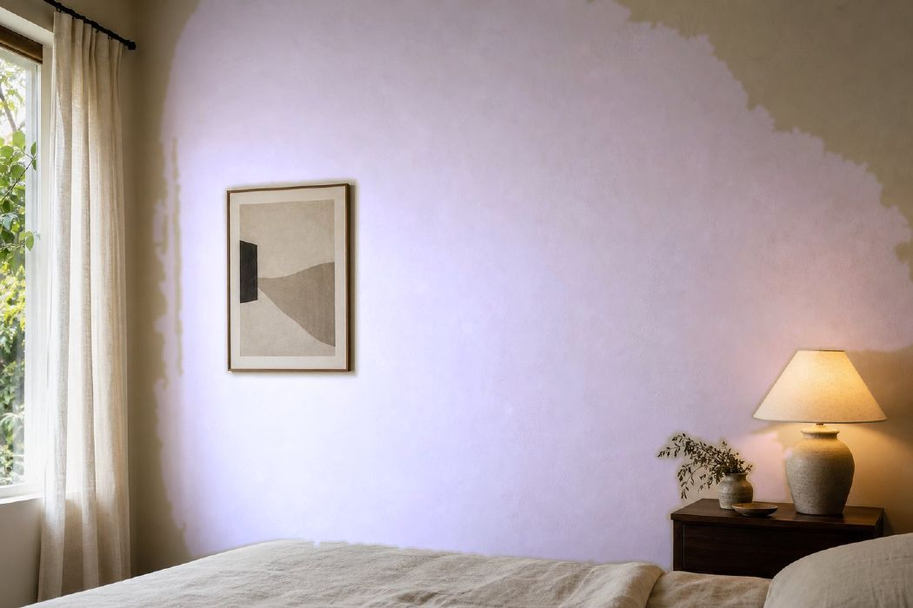

# Colortrend Ambiance — Wall Simulator

A single-file, interactive HTML5 Canvas studio for previewing **Colortrend Ambiance**
paint on a real photograph of a room. Click any wall and the whole surface is
repainted in the selected shade while every highlight, shadow, lamp glow and
plaster texture in the original photo is preserved.

**Open `index.html`** in any modern browser — no build step, no server, no
network access required (the room photo is embedded and the UI is fully
self-contained; the Tailwind CDN script is decorative only and has a local
fallback).



---

## Feature map

### 1. Perceptual wall segmentation
| Requirement | Implementation |
|---|---|
| Preserve natural lighting & texture | Per-channel **luminance multiplication**: each pixel's shading ratio `(source + 1) / (wallReference + 1)` is applied to the chosen paint colour, then linearly interpolated by the feathered mask alpha. Nothing is re-lit or flattened. |
| CIELAB + CIE76 ΔE | `rgbToLab()` uses the sRGB → XYZ (D65) → L\*a\*b\* pipeline with the proper piecewise transfer function. Acceptance is `ΔE76` against the **seed** colour, so a region cannot drift across a gradient. |
| 3×3 Sobel edge detection | `sobel()` returns raw L\* units per pixel (no per-image normalisation, one blown-out highlight can't change the thresholds). `consolidateGradient()` closes the gaps in 2–4 px soft photographic edges. |
| BFS flood fill | Explicit `Int32Array` queue, 4-connected, masked and bounded — no recursion, no stack limits. |
| Click to seed, multi-wall | Click the photo to add a region (up to 8). `All walls` paints every region; `This region` isolates one; `New seed` adds more. `Auto-detect walls` scans a probe grid and keeps up to three genuinely different surfaces. |
| Max height cutoff | `windows()` builds a soft vertical window; 5–100 %. |
| Horizontal length span | True dual-range slider with crossed-handle protection and a soft horizontal window. |

Two extra cues make the mask production-grade:

* **Local texture (σ of L\* in a 5×5 window, via integral images).** A painted
  wall is smooth (σ ≈ 0.3) even across a strong daylight gradient; folded bedding,
  foliage and lamp shades are not (σ ≈ 2–12). This is what stops the fill from
  treating a bright duvet as "wall" when its CIELAB value is nearly identical.
* **Post-processing:** majority despeckle → morphological opening (severs thin
  bridges to rugs and shelves) → seed-component isolation → small-hole filling →
  final despeckle → box-blur feathering.

### 2. Colour library
56 Colortrend Ambiance shades with realistic codes, including the specified
**Lavender Posy (6151P)** and **Savin Hill (1113D)**, plus neutrals, warms,
cools and deep accents.

* **Real-time partial search** over name, code and hex (`Lavender`, `6151`, `6151P`).
* **Category tabs:** All / Neutrals / Warms / Cools / Deep (a true partition of the library).
* **Active paint indicator** in the header *and* a hero swatch card showing name,
  code, hex and category, plus a live wall-coverage readout.

### 3. UI
Dark-mode, responsive two-pane layout, custom scrollbars, numbered control
cards, keyboard support (`O` compare, `R` reset, `Esc` dismiss), ARIA states on
tabs, switches, mode buttons and palette cards, drag-and-drop image loading.

Controls: lighting preservation, ΔE colour tolerance, Sobel edge guard, height
cutoff, horizontal span, feathering, plus overlay / seed-marker / sheen
switches, **Compare Original**, **Upload Room** and **Reset**.

### 4. Stability
* Every risky stage is wrapped: `guard()` for synchronous work,
  `fail(context, error)` for a single reporting funnel, and a
  `try/catch` around buffer precomputation, segmentation and rendering.
* A **visual error modal** reports the failing stage (`image upload`,
  `image load`, `segmentation`, `render`, `startup`, …) with the message and the
  top of the stack, plus **Dismiss** and **Reset simulator** actions.
* Specific, friendly failures for: non-image files, > 28 MB uploads, images
  under 240×160, undecodable files, CORS-blocked canvases, and out-of-memory
  buffer builds. Pixel buffers are capped at 2.4 MP so large uploads stay fast.
* `window.onerror` and `unhandledrejection` are also routed to the modal.

---

## Project layout

```
index.html                 ← the deliverable: complete, self-contained app
assets/room.jpg            ← default room photo (also embedded in index.html)
.build/                    ← authoring sources for index.html
  head.html                  markup head + full CSS design system
  body.html                  app markup
  app.js                     core maths (marked @@CORE-BEGIN@@/@@CORE-END@@) + UI
scripts/build.py           ← assembles the three sources + base64 photo
tools/core.test.mjs        ← 93 assertions on the colour/vision maths
tools/ui.test.mjs          ← 71 assertions driving the real app in jsdom
tools/pipeline.mjs         ← end-to-end run on the real photo + PNG preview
docs/example-lavender-posy.jpg
```

`index.html` is generated. Edit `.build/*` and run `npm run build` (or
`python3 scripts/build.py`).

## Commands

```bash
npm install          # test-only dependencies (jpeg-js, jsdom, parse5, pngjs)
npm run build        # regenerate index.html from .build/
npm test             # build + core + UI + pipeline checks
npm run dev          # build, then serve on http://0.0.0.0:4173
```

The verification tools read the **CORE module straight out of `index.html`**,
so the tests always exercise exactly the code the browser runs.

## Verification performed

* `tools/core.test.mjs` — LAB conversion accuracy (white = L\*100, greys
  achromatic, red/blue chroma signs), Sobel magnitude and absolute scaling,
  gradient consolidation, edge-guard curve, texture statistics, flood-fill
  behaviour (light falloff absorbed, bedding/ceiling rejected, monotonic in ΔE
  and edge guard, seed clamping), despeckle/morphology/connectivity/hole-filling,
  feathering, boundary windows, and the compositor (shadows retained, `light=0`
  collapsing exactly to the swatch, `alpha=0` byte-identical to the source,
  extreme paint colours and a near-black reference guarded).
* `tools/ui.test.mjs` — boots the unmodified `index.html` in jsdom against a
  software canvas: palette rendering, partial name/code search, category
  partition, selection syncing, seeding by click, paint modes, every slider
  (including the crossed dual-range guard), switches, compare toggle and
  shortcut, reset, clear/delete, auto-detect, canvas fitting, and the error
  boundary for PDF/oversized/undersized uploads.
* `tools/pipeline.mjs` — the full pipeline on the real photo at 1050×700
  (segmentation ≈ 150 ms, composite ≈ 13 ms) asserting no paint reaches the
  duvet, nightstand, lampshade, picture frame, window or curtain and that all
  four wall sample points are fully painted.

Browser QA in this environment was not possible (headless Chromium needs system
NSS libraries that cannot be installed here); the jsdom harness stands in for it.
